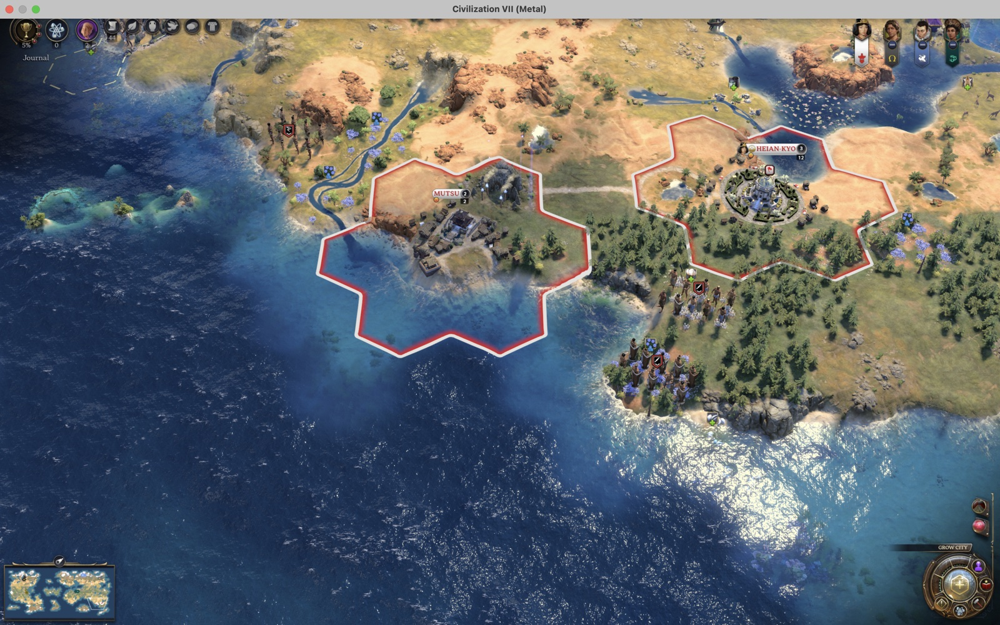
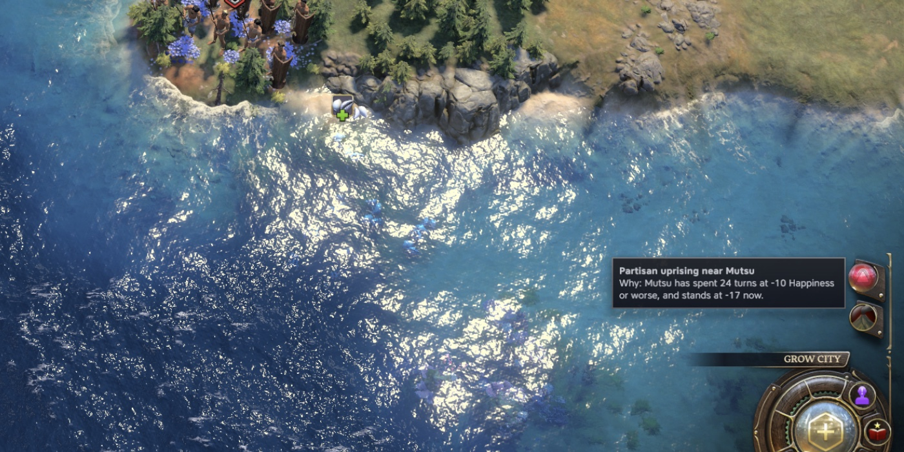
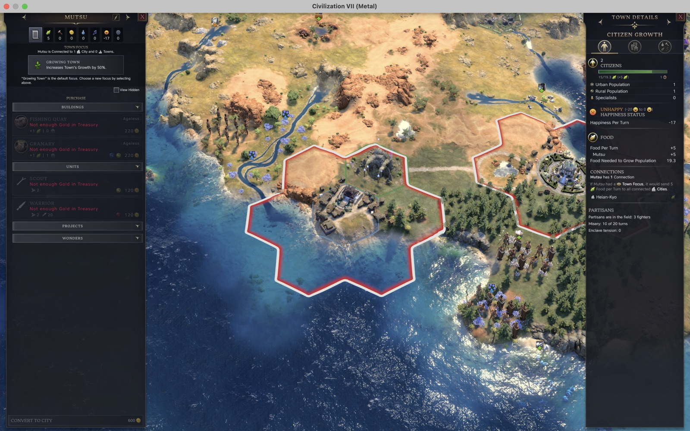

# Partisans

A Sid Meier's Civilization VII mod. When a settlement's people have a reason to rise, armed partisans appear in the
countryside around it and fight under the game's own independent-power AI. They raid, besiege and, if nobody answers
them, take the settlement, which the game then removes from the map. Putting them down is ordinary combat.



<table>
<tr>
<td width="50%"><br>The notice says where and why. Click it to jump there.</td>
<td width="50%"><br>The Partisans section in the settlement's details.</td>
</tr>
</table>

## What it does

- **Three things start a rising.** A settlement won over by a rival's culture (with Cultural Diffusion) may rise
  against its new owner, though that's rare, since most people who come over wanted to. It never happens between
  allies or friends, a few times in a hundred between neutral civilizations, and about one time in three at war. A
  recognised enclave (with Emigration) may take up arms against how it's treated. A war with the community's homeland
  is the trigger, and the host's treatment card sets the risk: rare with no card, much likelier under one of
  Emigration's suspicion cards, and a protective card lets the unrest settle. Any settlement that stays at -10
  Happiness or worse for twenty turns may rise, with the chance growing each turn, in any game.
- **Who fights.** Each civilization gets its own rebel people once per age, the first time a rising happens against
  it: rebels gather in a hideout a few tiles from one of its settlements, with a small band that keeps respawning
  until someone disperses it; the hideout keeps three units at most in the Antiquity Age, four in Exploration and
  five in Modern, besides the partisans out on a rising. Later risings against that civilization use the same people.
  Rebels that happen to be friendly to the civilization they rise against declare themselves against it when a rising
  starts, whether a player or the AI leads it.
- **The band.** Two to three units in the Antiquity and Exploration Ages, two in the Modern Age, two melee to one
  ranged, from the age's ordinary infantry at the tier the age's progress allows. They land two to four tiles out
  from the settlement that rose, city or town, so a garrison meets them. From there the game's independent AI decides
  where they go: they can attack that settlement or move on to other settlements nearby, your capital included. After a culture flip, hostile independent villages within six tiles may send a fighter or
  two of their own.
- **What you see.** A notification titled with the place ("Partisan uprising near Mutsu", or "Partisan Greek
  loyalists near Mutsu" after a culture flip) says why the people rose; click it to jump there. Others tell you when
  neighbours send fighters, when a rising is over and when a settlement is lost. A Partisans section in the City
  Details panel shows the settlement's misery turns and enclave tension.
- **National Parks.** In the Exploration and Modern Ages, the Happiness a settlement's park tiles pay counts a
  second time against misery, so a settlement with a park is slower to rise.
- **The same rules for everyone.** AI civilizations rise and fight their own partisans. Capitals, city-states and
  independent peoples never rise. At most one rising per settlement, two per civilization and six on the map at a
  time, and a settlement rests twenty turns after one.

## Options

Under Options, Mods, Partisans:

| Option | Default | What it does |
| --- | --- | --- |
| Risings after a culture flip | on | The Cultural Diffusion cause |
| Risings in a mistreated enclave | on | The Emigration cause |
| Risings after long misery | on | The cause that needs no other mod |
| Count culture flips from any mod | on | Off: only in games with Cultural Diffusion |
| National Parks calm the countryside | on | The park relief |

Settings keep their values from one launch to the next: the mod carries the Tower Settings Keeper file.

## Where it stops

The game creates its players when a game starts and never afterwards, so a rising can't found a new civilization. An
independent people can't hold a settlement, so partisans that take one burn it. The mod doesn't own the partisans:
the game's independent-power AI moves them and decides when they attack. Single-player and hotseat; in a network game
the mod only shows what an earlier session recorded. A save made with the mod needs it to load.

A rebel people takes one of the game's places for independent peoples. The Antiquity Age keeps a spare place for each
civilization, and Partisans keeps one in the Exploration and Modern Ages too, where the ordinary villages used to fill
every place in the first turn or two. So rebels can appear all age long. A mod that keeps more spare places keeps its
number.

A rebel people is spawned by the game's own crisis rule, which needs a marker: for one turn the settlement where the
rising starts holds a hidden building, the Partisan Muster. It can't be built or bought and is removed as soon as the
rebels have their hideout.

## Installing

Subscribe on the Steam Workshop, or unzip the
[latest release](https://github.com/tmtmiller1/CivilizationVII_Partisans/releases/latest) into `Mods/` under the
game's user folder and enable it in Additional Content. Works with Cultural Diffusion, Emigration and National Parks,
each optional.

## Languages

English, German, Spanish, French, Italian, Japanese, Korean, Polish, Portuguese (Brazil), Russian, Simplified Chinese
and Traditional Chinese. Corrections are welcome: see [text/README.md](text/README.md).

## Development

```sh
npm install
npm run verify          # lint, syntax and module checks, tests (the Civilopedia page harness among them)
npm run release:gate    # verify, then the tests again under c8 for the coverage figure
npm run gen-data        # regenerate data/partisans-muster.sql from scripts/gen-data.mjs
./release.sh            # the upload zip and the Workshop manifest
```

The design, the engine facts it rests on and the acceptance checks are in [docs/DESIGN.md](docs/DESIGN.md); what the
mod reads of other mods is in [docs/compatibility.md](docs/compatibility.md); the in-game harness is described in
[devtools/README.md](devtools/README.md). [CONTRIBUTING.md](CONTRIBUTING.md) has the checks and conventions, and
[docs/release-checklist.md](docs/release-checklist.md) the steps for a release.

## Civilopedia History Corrections

This mod also carries Civilopedia History Corrections, a text patch for
[Civilopedia Expanded: Independents](https://steamcommunity.com/sharedfiles/filedetails/?id=3815309882). With that mod
on, six East Asian history pages (Goguryeo, the Oirat, two Ryukyu pages, Nanzhao and Balhae) give each side where
historians in different countries disagree, and a few factual errors are fixed. With it off, the game's pages stay as
they are. The text is in `history-corrections/`, in English, Simplified Chinese and Traditional Chinese. Every Tower mod
that carries it writes the same text, so running several of them together is fine.

Those paragraphs were replaced because they didn't hold up. Some repeated Chinese state historiography as settled
fact, or recast a question most historians consider answered as still open. Some got basic dates and places wrong. And
the Oirat page called a genocide, the Qing destruction of most of the Dzungar people in 1755-1757, a "pacification."
I'm not leaving that in place. More corrections to Civilopedia Expanded may be added at any time, in any update.
Corrections may also be added for any other mod whose text I judge, in my sole discretion, to be bigoted,
genocide-denying or otherwise historically inaccurate. Running this mod alongside any of them means you accept those
replacements, including any added later. Switch this mod off and their pages read as their authors wrote them.

## License

Up to version 1.0.1 this mod was MIT, and copies of those versions stay MIT. Versions after 1.0.1 are under the Tower
Mod License 1.0 in [LICENSE](LICENSE), written in plain English.

You're welcome to play it, read the code to see how it works, and change your own copy for your own games. If you'd
like to reupload it, put parts of it in your own mod, or use it some other way, ask me first: open an issue here or
message Tower on Steam. `ui/settings-keeper.js` stays MIT so other mods can keep embedding it.

I don't want this mod's code, text or art used to train AI models, collected into AI training sets, or handed to AI
tools to copy into other projects, and the license doesn't allow it without my written permission. I also reserve the
rights to text and data mining of this work under Article 4(3) of the EU's Directive 2019/790.

Because the source is on GitHub, GitHub and its affiliates (Microsoft included) have their own license to it under
GitHub's Terms of Service, and since April 2026 that covers training their AI. Valve and Take-Two have the rights
their own terms give them. Sid Meier's Civilization VII and its assets belong to Firaxis Games and 2K. Material from
other people is listed in [LICENSE](LICENSE).
